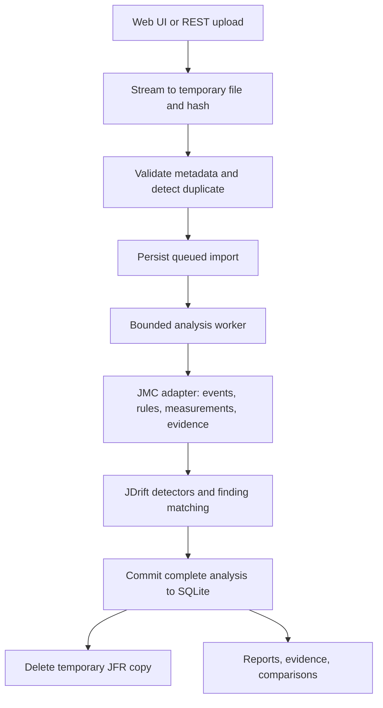

# JDrift architecture

Status: proposed v1 architecture. Product intent is described in [product.md](product.md). This document defines implementation boundaries; detector thresholds and resource limits will be validated using controlled recordings.

## Architectural priority

JDrift's primary responsibility is reasoning over recording history: determining whether a problem is fixed, detecting regressions, and identifying previously unseen problems. JMC-backed single-recording analysis produces the observations required by this workflow. Historical assessment, persistent finding identity, and evidence-backed conclusions are v1 capabilities, not later additions to an otherwise complete analyzer.

The history service consumes stored observations and measurements, independently of raw JFR and JMC types. Pairwise comparison is one operation used by that service; it does not replace analysis across a time slice or the last N recordings.

### Cumulative performance progress

V1 history must support a team demonstrating cumulative progress to an engineering lead or business owner. Keep a measurement history independent of detected findings: resolving five findings is not itself a measure of customer benefit or resource savings. Show trends across builds and periods, including changes too small individually to produce a noticeable customer improvement.

Provide a progress view with a user-selected baseline period and follow-up period. For each supported metric, show baseline and follow-up values, absolute and relative change where defined, intermediate observations, coverage, and workload comparability. Group by build when revision metadata is available and use capture time otherwise. Include all selected observations, not only favorable comparisons. Keep unresolved findings and regressions visible alongside improvements.

Candidate metrics include recorded JVM CPU load, estimated allocated bytes per second and per operation when available, GC pause distributions and pause-time ratio, supported G1 humongous-allocation or region measurements, and deoptimization counts/rates by method and reason. Select exact metrics according to event availability and collector; do not invent a generic humongous-GC count. CPU load is not CPU time per request, allocation rate is not allocation per request, and deoptimization counts are not a direct measure of performance impact. Preserve those distinctions in API labels and explanations.

Use windowed raw values or mergeable distribution summaries where period-level calculations require them. Do not average report percentiles or sum unrelated percentages. Report variation and sample coverage; small or noisy differences remain inconclusive until enough comparable observations exist. A missing event family is unavailable, not an improvement to zero.

Keep three separate summaries: finding lifecycle changes, observed JVM resource/behavior changes, and customer-facing outcomes. Customer impact is unverified unless latency, throughput, or other relevant outcome measurements are available. Do not create a single composite improvement score in v1. Validate cumulative progress with a synthetic sequence of several incremental improvements plus a lower-load control that must not be mistaken for efficiency improvement.

## Scope

V1 accepts JFR uploads through a web UI or REST API, analyzes them asynchronously, and stores measurements, evidence, reports, and finding history. Users can inspect a report, compare two analyses, and analyze history over a capture-time range or the last N reports without access to the original files.

V1 has no scheduled ingestion, folder monitoring, production capture, or S3 integration. It also defers AI analysis and provider integration, Jira/PR integrations, and external telemetry correlation. A small set of validated deterministic detectors provides the initial analysis.

Confirmed operating assumptions: recordings originate from Java 17 or 21, each file is smaller than 1 GB, and expected volume is approximately one recording per day. V1 runs locally. Validation initially uses only our synthetic dataset because production recordings are not yet available. Large-file tests must validate peak memory and temporary-disk use; file size alone does not predict parsed heap size.

Raw recordings remain the user's responsibility. Uploaded copies exist only as temporary processing inputs. JDrift deletes those copies after processing and requires a fresh upload for subsequent reanalysis.

## Stack and deployment

| Area | Decision |
| --- | --- |
| Language | Kotlin on the JVM |
| Build | Gradle Kotlin DSL, wrapper, centralized version catalog |
| HTTP server | Ktor with JSON serialization |
| Analysis | Published JMC core libraries behind a dedicated adapter |
| Persistence | SQLite with explicit SQL and ordered, versioned migrations |
| Frontend | React, TypeScript, Vite |
| Charts | Apache ECharts |
| Deployment | One application instance; Ktor serves the API and built frontend |

Use local persistent disk for SQLite and a separate temporary upload directory. Start with one analysis worker to bound memory consumption. Analysis does not execute on HTTP request threads and does not hold database transactions while parsing files.

SQLite is the initial persistence implementation. Enable foreign keys, use short transactions, configure a busy timeout, and evaluate WAL mode during implementation. Repository interfaces keep SQL out of application and domain code. Multiple application replicas and distributed execution are outside v1.

Pin dependency versions and select the runtime JDK during the initial compatibility experiment. The `libs/jmc` checkout is reference source, not a build dependency. Gradle resolves released JMC artifacts; the source checkout must be matched to the selected release when investigating API behavior.

## Modules and dependency boundaries

```text
domain/             Measurements, evidence, observations, findings, comparison rules
application/        Use cases and interfaces for analysis and persistence
adapter-jmc/        JMC parsing, rule execution, extraction, and conversion
adapter-sqlite/     SQL repositories and migrations
app/                Ktor routes, upload handling, worker lifecycle, configuration
scenario-harness/   Controlled workloads, recording generation, and manifests
web/                React application
libs/jmc/           Reference checkout
```

Dependencies point inward: application depends on domain; adapters implement application interfaces and use domain types; app wires the implementations. Domain has no JMC, Ktor, JDBC, or frontend dependencies.

JMC collections, attributes, quantities, rule results, and exceptions stay inside `adapter-jmc`. Its public interface returns JDrift types with explicit units, stable identifiers, and typed failure information. Ktor request/response DTOs and persistence rows are also mapped at their boundaries.

A minimal analysis port can start as:

```kotlin
interface RecordingAnalyzer {
    fun analyze(input: Path, options: AnalysisOptions): RecordingAnalysis
}
```

`Path` refers to a validated temporary file owned by the import workflow. This is a blocking, potentially expensive operation, invoked only by the analysis worker. `RecordingAnalysis` and `AnalysisOptions` contain no JMC types. Measure result size before deciding whether a streaming output interface is needed.

### Parsing strategy

Start with JMC for event extraction and built-in rule execution. A second pass using `jdk.jfr.consumer.RecordingFile` is permitted when it provides useful event access, evidence extraction, or analysis coverage that is awkward or unavailable through the selected JMC APIs. Avoiding a second parse is not a product requirement; evidence quality and validated analysis coverage take priority.

Evaluate the second path against controlled recordings and representative input sizes before adding it. Parsing the same file twice does not create information that was never recorded. Any benefit must come from accessing or processing existing data more effectively. Measure the additional runtime and peak memory, and prefer sequential passes when practical.

Both parsing paths stay behind the analysis port. JDK `RecordedEvent` and related consumer types must not enter domain objects, persistence contracts, or REST DTOs. If introduced, a JDK consumer extractor can live in a separate adapter coordinated by the analysis implementation. Define ownership of each metric and evidence family so overlapping passes do not double-count events or produce competing authoritative values. Record extractor versions and preserve consistent timestamps and units across outputs.

Keep the temporary input until all required passes and result persistence complete. A failure in a required pass fails the analysis; any optional pass failure must be represented explicitly as reduced coverage. Decide whether a second pass is worthwhile during implementation based on demonstrated benefit, without requiring a single-parser design.

## Import and processing lifecycle



1. Receive a multipart upload containing a file and optional application context. Accept service/application, environment, host/instance, build/revision, workload description, and user labels. Extract recognizable embedded metadata during analysis. Preserve metadata provenance and expose conflicts; explicit user overrides take precedence. If application or environment remains unknown, allow analysis but require classification before combining unrelated recordings into history.
2. Stream bytes to a generated temporary filename while computing SHA-256. Enforce configurable upload and queue limits; do not load the HTTP body into memory. Never use an uploaded filename as a filesystem path.
3. Validate basic file format and metadata after upload completion. Full parser validation occurs in the worker. Incomplete or rejected uploads are cleaned up.
4. Record the content hash, size, original filename, context, and queued analysis job. Return an import ID immediately after durable queue registration.
5. The worker claims a queued job, parses its temporary file, and builds detached JDrift results. Parsing and JMC objects remain outside database transactions.
6. Persist the complete analysis, evidence, observations, and finding associations in one transaction, then mark the job succeeded. Reports become visible only after this commit.
7. Delete the temporary input after success or terminal failure. Cleanup failures remain recorded for retry and do not silently discard a successfully committed report.

Job states are `QUEUED`, `RUNNING`, `SUCCEEDED`, and `FAILED`; upload transfer precedes queue registration. Track cleanup separately from analysis status. Failure responses contain a stable error code, a useful description, and whether a new upload is required.

On restart, reconcile jobs and temporary files: interrupted jobs with intact inputs can be requeued; jobs with missing inputs fail with a reupload requirement. Remove abandoned partial uploads and terminal-job files. This housekeeping is independent of deferred source monitoring. Make result publication idempotent so recovery cannot create duplicate observations.

Deduplication uses recording content hash plus application/environment context, analyzer version, and configuration hash. Repeated submissions for the same analysis return the existing job or report. Conflicting metadata must be surfaced rather than silently replacing prior context. A new analyzer version creates a separate analysis; a failed attempt can be retried through a new upload.

## Analysis pipeline

The adapter loads events and produces two complementary outputs: selected JMC rule results and structured extracted facts. JDrift then applies its own temporal detectors to those facts. Do not infer measurements by parsing human-readable rule descriptions.

Persist rule ID, engine version, configuration, outcome, available structured values, and explanations. Map JMC severity explicitly; it is not a probability of correctness. Record skipped or unsupported detectors separately from detectors that ran and found no issue.

The initial detector scope is CPU concentration, burst versus sustained execution, allocation pressure, GC pauses, and recorded monitor contention. Add each detector only after its scenario validates the measurement and interpretation. JIT compilation and deoptimization begin as grouped observations with evidence; stronger diagnoses require separate validation.

Time-window aggregation must retain the actual covered duration, sample counts, measurement semantics, and missing-data indicators. Store observed JVM CPU load separately from execution-sample share. Allocation estimates must identify their event source and weighting method. Counts of recorded contention events describe capture coverage, not necessarily every contention event in the process.

Use deterministic window boundaries relative to recording start, explicit threshold configuration, stable ordering, and tie-breakers. Analysis identity includes JMC version, JDrift detector version, extraction schema version, and configuration hash. Identical inputs and configuration should reproduce analytical content; operational timestamps and generated IDs are excluded from that equality.

## Domain and persistence model

| Entity | Purpose and main contents |
| --- | --- |
| Recording | Content hash, original filename, application/environment, capture interval, JDK and JVM metadata, optional revision and workload context; no raw bytes |
| Import job | Processing status, attempt details, timestamps, error information, temporary-input reference and cleanup status |
| Analysis run | Recording ID, analyzer versions, configuration hash, event coverage, limitations, completion metadata |
| Measurement | Metric key, unit, value, scope, interval, sample count, estimation method and coverage |
| Stack | Structured frames, method signatures, available line/bytecode positions and truncation indicators |
| Evidence | Versioned extracted payload, recording/analysis provenance, interval, stack references and selection limitations |
| Detector result | Detector ID, evaluated/skipped/error outcome, severity, structured values and explanation |
| Finding | Stable identity within application/environment, detector family, subject, first/last observed capture time |
| Observation | Finding occurrence in an analysis, affected interval, measurements, severity and evidence links |

An analysis run is the durable basis of a recording report. Render report DTOs from stored results; do not use Markdown as primary storage. Comparisons are initially calculated from two immutable analysis runs and a versioned comparison policy.

Use indexed relational columns for IDs, timestamps, metric keys, and searchable context. Store variable evidence payloads as versioned JSON, compressed into SQLite BLOBs where useful. Start with this inspectable representation; a custom binary format is deferred until measured size or access patterns justify it.

## Evidence retention without raw JFR

Retain time-window measurements and relevant stack aggregates beyond the report's top N findings. Top N is a presentation limit, not the extraction limit.

Evidence should contain enough extracted fields to explain the reported claim without reopening JFR: timestamps, event kind, durations or weights, thread details where relevant, and referenced stacks. Deduplicate repeated stacks. Bound evidence volume with explicit selection rules, and preserve total counts plus truncation or sampling metadata. Never silently turn missing evidence into zero activity.

Evidence is a derived record, not a byte slice guaranteed to be a valid standalone JFR. It supports defined drill-down views, not arbitrary future event queries. Record the original content hash for provenance. Adding new extractors or rerunning JMC requires reuploading the original recording.

Raw input cleanup happens only after the analysis transaction commits, or after terminal failure is recorded. Retention of derived results is separate from input cleanup and must not cascade accidentally from deleting an import's temporary file.

## Finding identity and comparison

Metadata may come from standard JVM events or application-specific custom events. Preserve useful discovered metadata as typed key/value attributes with event and field provenance. Do not assume a universal production metadata schema. V1 supports explicit context and validated known mappings; user-configurable metadata schemas and mapping rules are deferred. Synthetic recordings should include custom metadata variants to exercise this boundary.

Start with deterministic fingerprints combining application/environment, detector family, and a normalized subject such as a method signature, selected stack frames, or monitor class. Exclude volatile thread IDs and timestamps. Preserve full evidence separately from the normalized fingerprint and version the fingerprint algorithm.

Exact fingerprint matches support known and newly observed labels in v1. Unmatched subjects remain separate; do not silently merge likely matches across substantial code changes. Arrival order must not replace recording capture time when deriving first/last seen or history.

Comparison operates on stored measurements and observations. Check application/environment, capture configuration, duration, event availability, analyzer semantics, and available workload context. Report comparability per metric rather than declaring the entire pair equivalent by default.

Show absolute changes and relative changes where mathematically meaningful. For a zero baseline, show the absolute change and an explicit undefined relative percentage. Normalize by time only for metrics where it is valid; normalize by completed operations only when that denominator is available.

V1 produces explicit historical assessments for fixes, regressions, and new problems. Each assessment records the selected baseline and follow-up analyses, policy version, comparable measurements, evidence references, and limitations. Missing events or low coverage produce insufficient evidence. A missing observation alone is not a verified fix; causal attribution to a PR is outside v1.

For fix assessment, let the user select a baseline and a follow-up window, or a change boundary, without requiring a Jira issue or PR. Apply detector-specific criteria and require adequate comparable follow-up coverage before reporting the symptom resolved under the observed conditions. Otherwise report improved, persisting, worsened, or insufficient evidence. Never claim universal absence beyond the observed workload and period.

For regression assessment, identify a materially worsened measurement or recurrence after a supported resolution, using configured effect thresholds and sufficient coverage. For novelty, compare a finding fingerprint against retained prior history in the same application/environment, not merely the selected display window. If prior history is unavailable, label the finding first observed in available history. A known problem that returns is recurring, not new.

## REST API and web UI

History is a v1 requirement. Select an application/environment and either a capture-time range or the last N recordings ordered by capture time, not import time. Use one compatible analysis per recording to avoid counting reanalysis as another observation. Return measurement timelines, finding occurrence history, newly observed and continuing concerns, and measured improvements or deterioration. Show gaps and incompatible analyses explicitly; absence does not establish resolution. Aggregate rates with valid denominators and never average percentiles as if they were raw samples.

Proposed endpoints:

| Endpoint | Behavior |
| --- | --- |
| `POST /api/imports` | Multipart JFR and metadata upload; returns `202` and an import ID for accepted work |
| `GET /api/imports/{id}` | Job status, errors, cleanup status where relevant, and completed analysis reference |
| `GET /api/recordings` | Paginated recording metadata with application/environment filters |
| `GET /api/analyses/{id}` | Report summary, coverage, detector outcomes, measurements and observations |
| `GET /api/analyses/{id}/timeline` | Windowed measurements with bounded query resolution |
| `GET /api/evidence/{id}` | Decoded evidence and its selection/coverage limitations |
| `GET /api/findings/{id}` | Finding identity and paginated observation history |
| `GET /api/comparisons?baseline={id}&candidate={id}` | Comparison of two analysis IDs and comparability explanations |
| `GET /api/history` | Application/environment history selected by capture-time range or last N recordings, with trends and a deterministic summary |

An exact completed duplicate may return `200` with the existing analysis reference; an in-progress duplicate returns its existing job. Use consistent structured errors and document limits. Public APIs accept uploads, not arbitrary server filesystem paths or URLs.

Initial UI views are import/status, recording list, report with timeline and evidence, finding history, two-report comparison, and historical analysis with time-range/last-N selection. The UI and external callers share the same REST endpoints. Poll job status initially; live streaming updates are unnecessary for v1.

## Operational boundaries

V1 starts as a local or trusted internal single-instance deployment. Bind to loopback by default; external exposure requires an authenticated deployment boundary. Do not assume recorded paths, thread names, or event payloads are safe HTML. Render them as text and keep raw event content out of routine logs.

Make upload size, temporary disk usage, queued job count, evidence volume, and worker concurrency configurable. Benchmark JMC heap use with representative recordings before setting defaults. One in-process worker is the initial design; process isolation is the next option if malformed or large recordings cannot be handled reliably within that boundary. A thread timeout alone is not assumed to stop parser work safely.

Log job IDs, durations, analyzer versions, counts, and failure codes. Test backup and restore of SQLite including evidence, using a consistent backup method. Database schema migrations run before imports are accepted.

## Delivery and validation

1. Build the Kotlin/Gradle skeleton and adapter boundary. Generate healthy, sustained-CPU, and burst scenarios with timestamped manifests. Validate extraction and selected JMC rules against the pinned dependency release.
2. Add allocation, GC, contention, and JIT recordings incrementally. Confirm expected events in each recording; a scenario name alone is not ground truth.
3. Implement REST upload, durable job state, SQLite results, cleanup, and restart recovery. Exercise duplicate uploads, invalid files, missing temporary inputs, and persistence failures.
4. Build the UI and comparison workflow. Demonstrate that stored evidence and comparisons still work after temporary JFR files have been removed.
5. Complete finding matching, history queries, and fix/regression/novelty assessments. Validate against repeated runs, before/after variants, and deliberately incompatible captures. This is required for v1 completion.

An early technical acceptance case distinguishes sustained and burst recordings involving the same method. The v1 product acceptance case imports a sequence containing a baseline, a persistent problem, a fixed variant, a recurrence, and an unrelated new problem. Both capture-time and last-N history queries must correctly assess these transitions with supporting evidence, including after temporary JFR files are removed. Incompatible workload and missing-event variants must yield insufficient evidence rather than false fixes or regressions.

## Deferred extensions

Folder monitoring, scheduling, and S3 connectors will submit inputs to the existing import workflow rather than implement separate analysis pipelines. Their release assignment is deferred.

V2 should support AI provider and agent integration, including OpenAI/ChatGPT/Codex and Claude through supported SDK or CLI interfaces. Exact transports and authentication will be evaluated for each provider during v2. Keep provider-specific types behind adapters and expose versioned structured reports and evidence for consumption. AI annotations must retain evidence references and provider/model provenance and remain separate from deterministic measurements. V1 neither invokes providers nor sends recording-derived data externally.

The primary v2 agent workflow is inbound access: an external AI agent calls JDrift's API or a thin JDrift CLI to list recordings, query historical windows, inspect findings, compare analyses, request assessments, and retrieve evidence. The CLI should emit versioned JSON, stable IDs, pagination, and structured errors, using the same application services as the UI. No raw recording transfer is required. Outbound provider invocation is a separate integration concern; agent access must not depend on JDrift hosting an LLM or storing provider credentials.

V3 adds triage: Jira and PR links plus user notes attached to persistent findings. Keep those user-authored records separate from computed observations and assessments so reanalysis does not overwrite investigation history.

Use JDK 21 as the initial application runtime and validate inputs produced by Java 17 and 21. Open decisions for the initial experiment are the JMC release, measurement windows, detector thresholds, and evidence/resource limits. Resolve these from synthetic data, including recordings approaching the expected size limit; add production validation when recordings become available.
